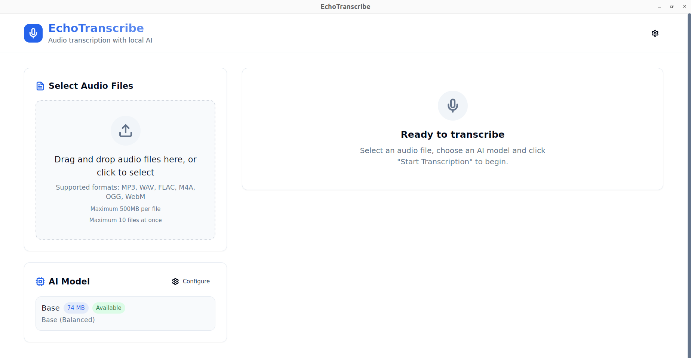

# EchoTranscribe 🎙️

Uma aplicação de desktop open-source para transcrição de áudio usando IA local. Privado, seguro e eficiente.



## ✨ Características

- 🔒 **Completamente Local**: Seus arquivos de áudio nunca saem do seu computador
- 🤖 **IA Avançada**: Usa modelos Whisper para transcrição de alta qualidade
- 🎨 **Interface Moderna**: Design clean e intuitivo com suporte a tema escuro
- 📁 **Múltiplos Formatos**: Suporte para MP3, WAV, FLAC, M4A, OGG e WebM
- 🔄 **Transcrição em Lote**: Processe múltiplos arquivos simultaneamente
- 🌍 **Detecção Automática**: Identifica automaticamente o idioma do áudio
- ⏱️ **Timestamps Precisos**: Timestamps por palavra para navegação detalhada
- 💾 **Exportação Flexível**: Exporte para TXT, SRT ou JSON
- ⚙️ **Configurações Persistentes**: Tema escuro/claro e idioma salvos entre sessões
- � **Multilíngue**: Interface em inglês, português e espanhol (expansível)
- ⚡ **Performance**: Otimizado para velocidade e eficiência
- 🖥️ **Cross-Platform**: Funciona no Windows, macOS e Linux🎙️

Uma aplicação de desktop open-source para transcrição de áudio usando IA local. Privado, seguro e eficiente.


## ✨ Características

- 🔒 **Completamente Local**: Seus arquivos de áudio nunca saem do seu computador
- 🤖 **IA Avançada**: Usa modelos Whisper para transcrição de alta qualidade
- 🎨 **Interface Moderna**: Design clean e intuitivo com suporte a tema escuro
- 📁 **Múltiplos Formatos**: Suporte para MP3, WAV, FLAC, M4A, OGG e WebM
- � **Transcrição em Lote**: Processe múltiplos arquivos simultaneamente
- 🌍 **Detecção Automática**: Identifica automaticamente o idioma do áudio
- ⏱️ **Timestamps Precisos**: Timestamps por palavra para navegação detalhada
- �💾 **Exportação Flexível**: Exporte para TXT, SRT ou JSON
- ⚡ **Performance**: Otimizado para velocidade e eficiência
- 🌐 **Cross-Platform**: Funciona no Windows, macOS e Linux

## 🚀 Início Rápido

### Pré-requisitos

- **Node.js** (versão 18 ou superior)
- **Python** (versão 3.8 ou superior)
- **Rust** (para compilação do Tauri)

#### Linux (Ubuntu/Debian)
```bash
sudo apt update
sudo apt install libwebkit2gtk-4.0-dev libssl-dev libgtk-3-dev libayatana-appindicator3-dev librsvg2-dev libjavascriptcoregtk-4.0-dev
```

#### macOS
```bash
# Usando Homebrew
brew install --cask xcode-command-line-tools
```

#### Windows
No Windows, você precisará do Microsoft Visual Studio C++ Build Tools.

### Instalação para Desenvolvimento

1. **Clone o repositório**
```bash
git clone https://github.com/seu-usuario/echo-transcribe.git
cd echo-transcribe
```

2. **Instale as dependências do Node.js**
```bash
npm install
```

3. **Configure o ambiente Python**
```bash
python -m venv .venv
source .venv/bin/activate  # No Windows: .venv\Scripts\activate
pip install -r src-tauri/backend/requirements.txt
```

4. **Execute em modo de desenvolvimento**
```bash
npm run tauri dev
```

### Instalação para Produção

Baixe a versão mais recente dos [Releases](https://github.com/paladini/echo-transcribe/releases) para seu sistema operacional.

## 🐳 API self-hosted (Docker)

O **aplicativo desktop Tauri continua sendo o produto principal**. Use Docker só se quiser o backend FastAPI/faster-whisper numa máquina **sem Node, Rust ou GTK** (homelab, NAS ou Linux headless).

Os modelos Whisper ficam em volumes do Compose. O áudio é enviado como upload e processado **dentro do container**; não há serviço de transcrição na nuvem.

```bash
git clone https://github.com/paladini/echo-transcribe.git
cd echo-transcribe
docker compose up -d --build
```

Depois que uma tag `v*` for publicada, dá para pular o build local do PyTorch:

```bash
docker compose pull
docker compose up -d
```

- Docker Hub: [`paladini/echo-transcribe:cpu`](https://hub.docker.com/r/paladini/echo-transcribe)
- GitHub Container Registry: `ghcr.io/paladini/echo-transcribe:cpu`

Se essas tags ainda não existirem no registry, continue com `--build`.

Com o container saudável:

- API: http://localhost:8000
- Health: http://localhost:8000/health
- Swagger UI: http://localhost:8000/docs

Transcrever um arquivo (na primeira vez o modelo Whisper é baixado para o volume `echo-models`):

```bash
curl -F "file=@gravacao.mp3" -F "model=tiny" http://localhost:8000/transcribe
```

Formatos iguais ao app: MP3, WAV, FLAC, M4A, OGG, WebM. Modelos: `tiny`, `base`, `small`, `medium`.

Parar o container (os volumes com os modelos são preservados):

```bash
docker compose down
```

### Volumes

| Volume | Caminho no container | Uso |
|--------|----------------------|-----|
| `echo-models` | `/data/models` | cache dos modelos faster-whisper / CTranslate2 |
| `echo-hf-cache` | `/data/hf-cache` | cache de download do Hugging Face |
| `echo-uploads` | `/data/temp` | arquivos temporários de upload (apagados após cada job) |

### Variáveis de ambiente

O Compose define `HOST=0.0.0.0` para a API ser acessível no host. No desktop o bind continua `127.0.0.1`, a menos que você exporte `HOST`.

| Variável | Padrão no Compose | Notas |
|----------|-------------------|--------|
| `ECHO_PORT` | `8000` | Porta publicada no host |
| `HOST` / `ECHO_HOST` | `0.0.0.0` (container) / `127.0.0.1` (desktop) | Endereço de bind |
| `PORT` / `ECHO_PORT` | `8000` | Porta dentro do container |
| `ECHO_MODELS_DIR` | `/data/models` | Cache de modelos |
| `ECHO_TEMP_DIR` | `/data/temp` | Uploads temporários |
| `WHISPER_DEVICE` | `cpu` | Use `cuda` só com o override GPU |
| `WHISPER_COMPUTE_TYPE` | `int8` | Adequado para CPU |
| `CORS_ALLOW_ORIGINS` | `*` | Sem esta variável, o app desktop segue usando localhost / `tauri://localhost` |

Copie `.env.example` para `.env` se quiser outra porta. A imagem **não** contém segredos; este serviço não usa API keys.

### CPU vs GPU

A imagem padrão instala **PyTorch CPU** e funciona sem driver NVIDIA. A transcrição é mais lenta que em GPU, sobretudo com `small` e `medium`.

Override opcional de GPU (NVIDIA Container Toolkit; imagem bem maior):

```bash
docker compose -f docker-compose.yml -f docker-compose.gpu.yml up -d --build
```

Se o CUDA não aparecer no container, use só o arquivo CPU. Uma imagem com base CUDA (e suporte a NVIDIA DGX Spark) fica como follow-up.

### Notas Docker

- O primeiro `docker compose up --build` baixa o PyTorch (vários GB) e demora. Prefira `docker compose pull` quando `paladini/echo-transcribe:cpu` existir.
- O healthcheck usa o `GET /health` já existente.
- Este caminho **não** inclui a interface Tauri. Use `/docs` ou `curl`.
- Publicar a porta `8000` numa interface de rede expõe uma API **sem autenticação**. Para restringir ao host: `127.0.0.1:8000:8000`.

## 🎯 Como Usar

1. **Selecione arquivo(s) de áudio**
   - Arraste e solte um ou múltiplos arquivos na área indicada
   - Ou clique para selecionar arquivos (máximo 10 por vez)

2. **Escolha o modelo de IA**
   - **Tiny/Base**: Rápido, ideal para testes
   - **Small**: Melhor qualidade, velocidade média
   - **Medium**: Alta qualidade, mais lento

3. **Configure as opções**
   - Deixe a detecção automática de idioma habilitada (recomendado)
   - Ou especifique manualmente o idioma do áudio

4. **Inicie a transcrição**
   - Clique em "Iniciar Transcrição"
   - Acompanhe o progresso em tempo real
   - Para lotes, veja o progresso de cada arquivo

5. **Visualize e edite os resultados**
   - Veja o texto transcrito para cada arquivo
   - Navegue pelos timestamps de cada palavra
   - Edite o texto se necessário

6. **Exporte os resultados**
   - Exporte individualmente ou em lote
   - Formatos disponíveis: TXT, SRT, JSON

7. **Configure a aplicação**
   - Acesse as configurações para personalizar tema e idioma
   - Suas preferências são salvas automaticamente para próximas sessões

## 🛠️ Tecnologias

- **Frontend**: React + TypeScript + Tailwind CSS
- **Desktop**: Tauri (Rust)
- **Backend**: FastAPI (Python)
- **IA**: faster-whisper (OpenAI Whisper)
- **UI Components**: Radix UI + shadcn/ui

## 📋 Comandos Disponíveis

```bash
# Desenvolvimento
npm run dev          # Iniciar servidor de desenvolvimento do frontend
npm run tauri dev    # Iniciar aplicação Tauri em modo de desenvolvimento

# Produção
npm run build        # Build do frontend
npm run tauri build  # Build da aplicação completa

# Backend (Python)
cd src-tauri/backend
python main.py       # Iniciar servidor backend standalone

# API self-hosted (Docker, sem Node/Rust/GTK)
docker compose up -d --build
# GPU (opcional): docker compose -f docker-compose.yml -f docker-compose.gpu.yml up -d --build
```

## 🔧 Configuração

### Modelos de IA

O Echo-Transcribe baixa automaticamente os modelos de IA conforme necessário. Os modelos ficam armazenados em:

- **Linux/macOS**: `~/.echo-transcribe/models/`
- **Windows**: `%USERPROFILE%\\.echo-transcribe\\models\\`

### Formatos Suportados

| Formato | Extensão | Tamanho Máximo |
|---------|----------|----------------|
| MP3     | .mp3     | 500MB          |
| WAV     | .wav     | 500MB          |
| FLAC    | .flac    | 500MB          |
| M4A     | .m4a     | 500MB          |
| OGG     | .ogg     | 500MB          |
| WebM    | .webm    | 500MB          |

## 🐛 Solução de Problemas

### Problemas Comuns

**Erro: "Modelo não encontrado"**
- O modelo será baixado automaticamente na primeira execução
- Verifique sua conexão com a internet

**Erro: "Formato de arquivo não suportado"**
- Verifique se o arquivo está em um dos formatos suportados
- Tente converter o arquivo para MP3 ou WAV

**Aplicação não abre no Linux**
- Verifique se todas as dependências do sistema estão instaladas
- Execute: `sudo apt install libwebkit2gtk-4.0-37`

### Logs de Debug

Os logs da aplicação ficam em:
- **Linux/macOS**: `~/.echo-transcribe/logs/`
- **Windows**: `%USERPROFILE%\\.echo-transcribe\\logs\\`

## 🤝 Contribuindo

Contribuições são muito bem-vindas! Por favor, leia nosso [Guia de Contribuição](CONTRIBUTING.md) para começar.

### Desenvolvimento Local

1. Fork o projeto
2. Crie uma branch para sua feature (`git checkout -b feature/amazing-feature`)
3. Commit suas mudanças (`git commit -m 'Add some amazing feature'`)
4. Push para a branch (`git push origin feature/amazing-feature`)
5. Abra um Pull Request

## 📝 Roadmap

- [x] **0.1.0** ✅ **CONCLUÍDO**
  - [x] Suporte a transcrição em lote
  - [x] Detecção automática de idioma
  - [x] Timestamps precisos por palavra
  - [x] Exportação para múltiplos formatos (TXT, SRT, JSON)
  - [x] Tela de configurações com persistência
  - [x] Suporte a temas (claro/escuro)
  - [x] Sistema de localização (EN/PT/ES)
  
- [ ] **v0.2.0**
  - [ ] Suporte a mais modelos de IA
  - [ ] Melhorias na interface de timestamps
  - [ ] Suporte a mais idiomas da comunidade

- [ ] **Versões Futuras**
  - [ ] Interface para treinamento de modelos personalizados
  - [ ] API REST completa
  - [ ] Suporte a streaming de áudio
  - [ ] Marketplace de plugins

## 📄 Licença

Este projeto está licenciado sob a Licença MIT - veja o arquivo [LICENSE](LICENSE) para detalhes.

## 🙏 Agradecimentos

- [OpenAI](https://openai.com/) pelo modelo Whisper
- [Tauri](https://tauri.app/) pela framework de desktop
- [FastAPI](https://fastapi.tiangolo.com/) pelo framework backend
- [shadcn/ui](https://ui.shadcn.com/) pelos componentes de UI

## 📞 Suporte

- 📧 Email: [seu-email@example.com](mailto:seu-email@example.com)
- 🐛 Issues: [GitHub Issues](https://github.com/seu-usuario/echo-transcribe/issues)
- 💬 Discussões: [GitHub Discussions](https://github.com/seu-usuario/echo-transcribe/discussions)

---

**EchoTranscribe** - Transformando áudio em texto com privacidade e qualidade. 🎙️✨


